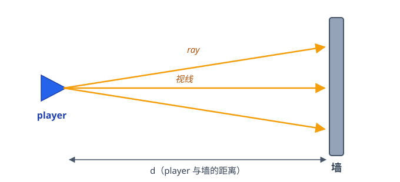
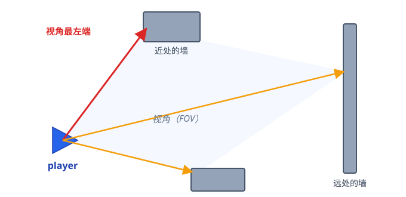
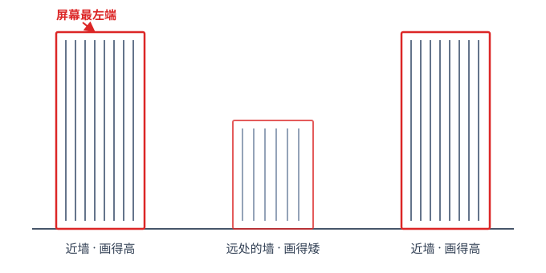
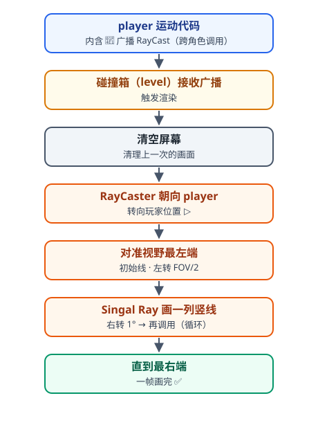
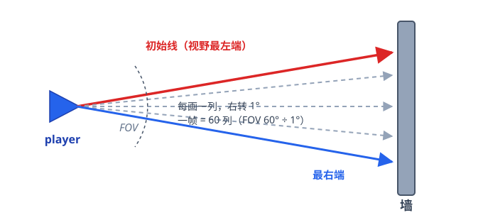

# 🧱 3D 的初步实现

> **本文是什么**：两页手写笔记的整理版，**结构完全按笔记原文还原**——
> 原理 → 例子 → 调用路径 → 代码大致结构。
> 对应工程：`Scratch 3D.sb3`（角色 `player` / `RayCaster` / `level`）。
> 笔记日期：2026-10-01 · 整理：同日

---

## 目录

1. [原理](#一原理)
2. [例子](#二例子)
3. [调用路径](#三调用路径)
4. [代码大致结构](#四代码大致结构)

---

<a id="一原理"></a>
## 一、原理



> **根据投射线的长度——即 player 与墙的距离——在屏幕上画竖线。**

| 投射线长度（player 到墙） | 屏幕上的竖线 |
|:---:|:---:|
| 短（离得近） | 画得**高** |
| 长（离得远） | 画得**矮** |

---

<a id="二例子"></a>
## 二、例子



上面是俯视图：player 站在近墙之间，一扇形的光线扫出去——
红的是**视角最左端**，橙色的分别打在近处和远处的墙上。



把每根光线按"近高远矮"画成竖线，就得到右图这个一眼像 3D 的画面：
**两侧近墙画得高、中间远墙画得矮**，和红笔草稿一模一样。

---

<a id="三调用路径"></a>
## 三、调用路径

笔记里画的是一条自上而下的箭头链：



配合 FOV 扇形看最后两步——从**初始线**开始，每画一列右转 1°，直到最右端：



---

<a id="四代码大致结构"></a>
## 四、代码大致结构

笔记把整个渲染拆成三段，正好对应工程里的三块积木：

### ① 接收 Raycast —— 广播的接收端

```text
当接收到广播 [Raycast]
    清屏
    设置笔颜色为 53
    粗细设置为 8
    面向 player
    调用 Raycast
```

### ② Raycast —— 扫描循环

```text
Set x to [-240]              ← 首列的屏幕 x 坐标
turn FOV / 2                 ← 左转半个视场角，对准最左端（初始线）
Repeat FOV 次 {
    Singal Ray               ← 画一列竖线
    turn ↻ 1°                ← 转一度
    change X by 480 / FOV    ← 列坐标右移一格
}
```

### ③ Singal Ray —— 一根光线 = 一列竖线

```text
移到 player
重复直到 碰墙  { mov 4 steps  }      ← 大步冲
重复直到 脱墙  { mov -1 step }      ← 小步退，停在墙沿
distance 设为 到 player 的距离
height  设为 4000 ÷ distance        ← 近大远小的换算
移动到 (X, height)
落笔
将 Y 设为 -height                    ← 从 +height 画到 -height
抬笔
```

### 📝 笔记 vs 工程（实现时的小改动）

| 笔记写法 | 工程实际 | 为什么改 |
|---|---|---|
| 步长 4 / -1 | 2px 冲 / 0.5px 退 | 冲得更细、退得更准，边缘不抖 |
| 首列 X = -240 | X = -236（= RES/2 − 240） | 让 8px 笔触正好居中在每列上 |
| Repeat FOV 次 | Repeat 60 次（= 480 ÷ 8） | FOV=60 时两者恰好相等，工程里写死列数 |
| 颜色 53、粗细 8 | 相同 ✅ | 一致，未改 |

---

<div align="center">

**一根光线 = 一列竖线 · 近高远矮 · 60 根拼出一帧** 🧱

*整理自 2026-10-01 两页手写笔记 · 与工程 <code>Scratch 3D.sb3</code> 核对*

</div>
