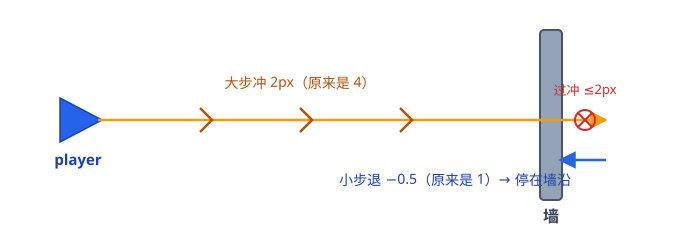
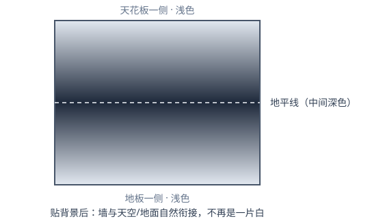
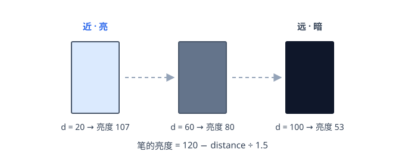
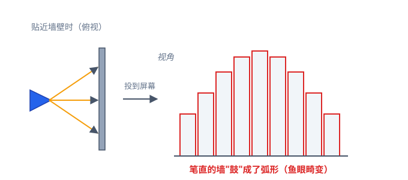
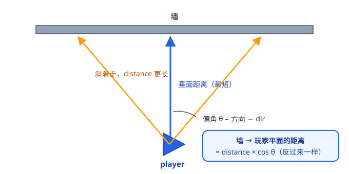
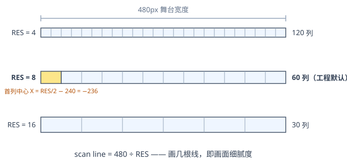
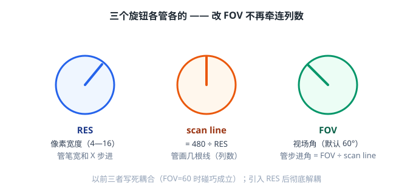

# 🧱 3D 的迭代优化

> **本文是什么**：三页手写笔记的整理版，**结构按笔记原文还原**——
> 修改 → 改善性改动 → 3D→3 → 3D→4 → 3D→2。
> 对应工程：`Scratch 3D.sb3`。前篇：[3D的初步实现](3D的初步实现.md)。
> 笔记日期：2026-10-01 · 整理：同日

---

## 目录

1. [修改：鱼眼校正的代码落点](#一修改)
2. [改善性改动：步长细化 + 贴背景](#二改善性改动)
3. [3D→3：明暗雾化（远→暗、近→亮）](#三3d3)
4. [3D→4：处理视角鱼眼](#四3d4)
5. [3D→2：用 RES 与 scan line 控制细腻度](#五3d2)
6. [笔记 vs 工程](#六笔记-vs-工程)

---

<a id="一修改"></a>
## 一、修改：鱼眼校正的代码落点

两处小改动，让"斜着看墙"不再画歪（原理在 §四）：

| 位置 | 积木 | 作用 |
|---|---|---|
| `RayCaster` | `set dir to direction` | 开扫前把玩家朝向**拍张快照**存进 `dir` |
| `Singel Ray` | `set distance to (distance to player)` | 先量出斜着的径向距离 |
| `Singel Ray` | `set distance to distance × cos(direction − dir)` | 乘上偏角的余弦，换算成垂面距离 |

**为什么必须先拍快照？** 扫描过程中 `RayCaster` 自己一直在转，
`direction` 每画一列就变 1°；而"玩家正前方"是整帧不变的基准。
`dir` 就是那个不变的基准——没有它，每一列算出来的偏角都是错的。

**两个变量各是什么：**

- `direction` —— 当前这根光线指的方向，随扫描一列列变化；
- `dir` —— 玩家正前方的快照，一帧只拍一次，全程不变；
- `direction − dir` —— 这根光线偏离正前方多少度（**偏角**）。

> 中间那列偏角为 0，cos 0 = 1，距离不变；
> 偏 30° 的边缘列，cos 30° ≈ 0.866——斜量出来的 11.5 会被修回 11.5 × 0.866 ≈ 10。
> 这组数字在 §四 有完整的几何解释。

---

<a id="二改善性改动"></a>
## 二、改善性改动：步长细化 + 贴背景

### 步长细化（在 Singel Ray 中）

```text
go to player
repeat until touching level {
    move 2        // 原来是 4
}
repeat until not touching level {
    move -0.5     // 原来是 1
}
```



**改小步长换来了什么：**

| | 原步长 4 / 1 | 新步长 2 / 0.5 |
|---|---|---|
| 大步过冲 | 最多偏 4px | 最多偏 2px |
| 小步停不准 | 误差可达 1px | 误差 ≤0.5px |
| 视觉效果 | 贴墙时边缘抖动 | 边缘稳了 |
| 代价 | 快 | 每根射线多走几步，稍慢 |

测距的原理不变：先**大步冲**（撞到墙为止，允许冲过头），
再**小步退**（退出墙体的瞬间，正好停在墙沿）。
粗定位靠大步省时间，精定位靠小步保质量。

### 贴背景

给舞台贴渐变背景——**中间（地平线）深色、两边浅色**，天花板和地板不再是一片白：



为什么值得做：不贴背景时，画面上下是纯白，墙柱像凭空浮在纸面上；
有了"中间深、两边浅"的渐变，深色地平线把远处沉下去，
墙的下沿和地面、上沿和天花板都**自然衔接**，纵深感立刻出来。
（工程最终把渐变画在 Stage 上：地平线黑、上下边缘白。）

---

<a id="三3d3"></a>
## 三、3D→3：明暗雾化（远 → 暗、近 → 亮）

在 Singal Ray 中加一行：

```text
set pen brightness to [120 − (distance / 1.5)]
```



**这行在模仿什么？** 现实里空气不是完全透明的——东西越远，颜色越"沉"。
给每根竖线按距离降低亮度，画面就有了空气感：

- 离得近（d 小）→ 亮度接近 120 → 墙又亮又清楚；
- 离得远（d 大）→ 亮度一路下调 → 墙渐渐沉进背景里；
- 除以 **1.5 是在调"雾的浓度"**：这个数越大，雾越淡（暗得越慢）。

同一面走廊的两头，靠亮度差就能读出"哪边远哪边近"——
配合 §四 的鱼眼校正，立体感不再只靠高度撑。

---

<a id="四3d4"></a>
## 四、3D→4：处理视角鱼眼

**问题**：贴近墙壁时，笔直的墙在屏幕上会"鼓"成弧形——笔记里画的就是这个：



**为什么会鼓？** 看俯视图就明白：同一面平墙，正对的那根光线**垂直**打到墙上，
路程最短；斜到两边的光线斜着走，路程必然更长。
如果拿到多长就画多矮，两边的墙就被"冤枉"画矮了——
**中间凸、两边凹**，正是鱼眼畸变。（这跟广角相机拍直线会弯，是同一个数学。）

**思路**：把追踪算法从「墙 → 玩家」改为「墙 → 玩家的垂面」——
不再用斜着的径向距离，改用垂直于玩家视线的平面距离。
可以把垂面想成放在玩家面前的一块透明投影幕布：
墙的真实高矮，应该看光线穿过**幕布**的位置，而不是光线飞了多远：



**一行治好：**

```text
墙 → 玩家平面的距离 = distance × cos(玩家角度 − 初始角度)
```

拿数字验证一遍：垂直光线量得 10，斜 30° 的光线量得 11.5，
11.5 × cos 30° = 11.5 × 0.866 ≈ 10——三根光线换算后距离一致，墙直了。

> 「反过来一样」——cos 是偶函数，cos(−θ) = cos θ，
> 所以光线偏在正前方左边还是右边，算法不用区分。
> 这正是 §一 那两行修改的由来：`dir` 就是这里的"初始角度"快照。

---

<a id="五3d2"></a>
## 五、3D→2：用 RES 与 scan line 控制细腻度

**起因**：笔直的竖线一根根画上去，画面是"细条"拼的，太糙。
引入变量 **RES（像素宽度，取 4—16）**，用它设置笔宽——每根线不再是 1px 细线，
而是一个 RES px 宽的色块，粗粒但快。

**新问题**：FOV 一变就出问题——或者说 Raycast 函数有问题：
**线的数量（画面细腻度）应该跟着 RES 改变**，而不是跟 FOV 挂钩。
于是重命名一个变量，把"画几根线"变成独立参数：

```text
set scan line to 480 / RES      ← 画几根线，即画面细腻度
```

**解耦之后的 Raycast**，三个参数各管一段：

```text
set x to RES / 2 − 240          ← 首列中心（让笔触正好居中在每列上）
turn ↺ FOV / 2                  ← 左转半个视场角，对准最左端（初始线）
set scan line to 480 / RES      ← 列数：480px 里能放下几块
repeat scan line {
    Singal Ray                  ← 画一列竖线
    turn ↻ FOV / scan lines     ← 步进角：把 FOV 均分给每一列
    change x by RES             ← 屏幕上前进一格
}
```





**为什么这是个好设计：** 以前"转多少度、画几根、每根挪多宽"互相写死
（FOV=60 时碰巧全都凑对，一改就散架）；
现在 RES 管笔宽、scan line 管列数、FOV 管张角，**改任何一个都不会弄坏另外两个**。
代价也明码标价：RES 调小=细腻但帧率降，调大=马赛克但流畅（见 README §7 调优速查）。

---

<a id="六笔记-vs-工程"></a>
## 六、笔记 vs 工程

| 笔记 | 工程 | 说明 |
|---|---|---|
| dir 快照 + cos 校正 | 相同 ✅ | `dir` / `scan lines` 等变量沿用至今 |
| 步长 2 / −0.5 | 相同 ✅ | "原来是 4 / 1" 已进历史 |
| 亮度 = 120 − distance ÷ 1.5 | 120 − distance | ÷1.5 后来被简化（还残留过无作用的 ÷1，见 README §7） |
| scan line = 480 ÷ RES | 相同 ✅ | RES=8 → 每帧 60 根 |
| X = RES/2 − 240 | 相同 ✅ | 首列居中的小技巧 |
| 背景：中间深色、两边浅色 | 地平线黑、上下边缘白 | 同一套渐变思路 |

**一条主线读下来**：步长管准头 → 亮度管远近 → cos 管歪直 → RES 管粗细——
四件事各修一个缺陷，合起来画面才"像那么回事"。

---

<div align="center">

**RES 管粗细 · 亮度管远近 · cos 管歪直** 🧱

*整理自 2026-10-01 三页手写笔记 · 与工程 <code>Scratch 3D.sb3</code> 核对*

</div>
