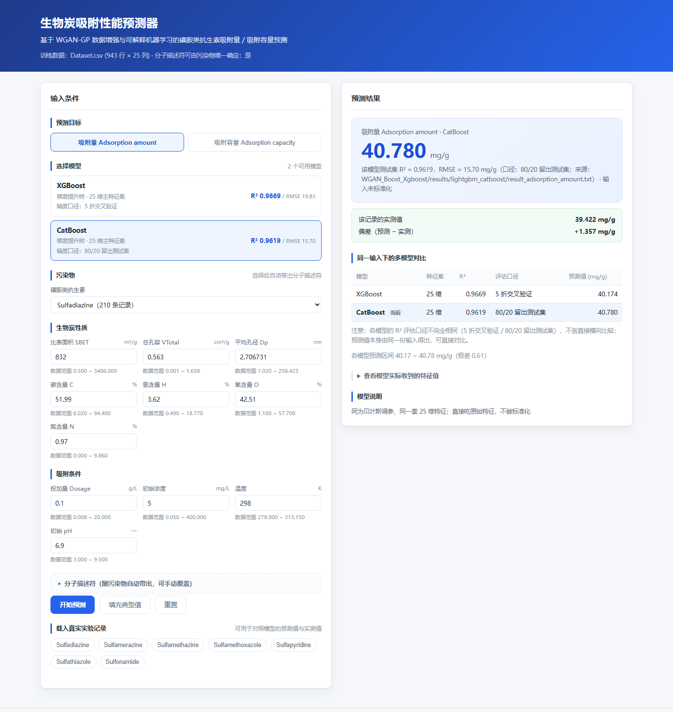
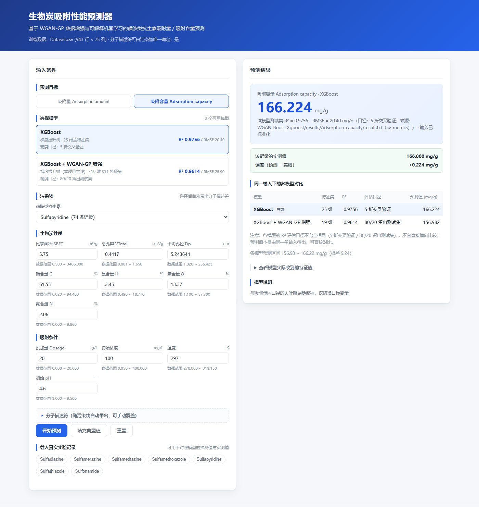
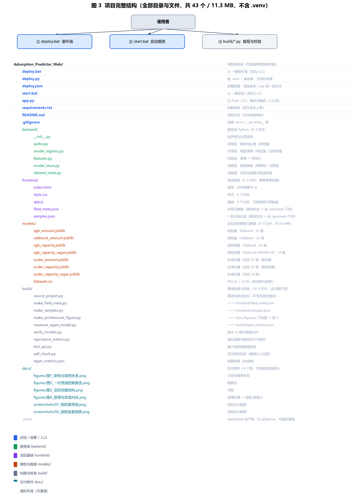
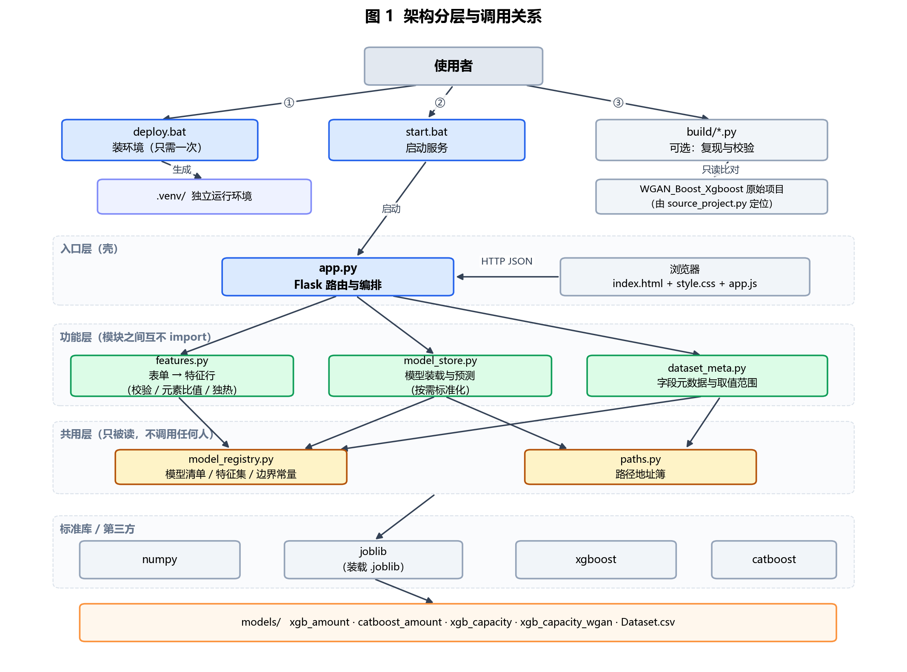
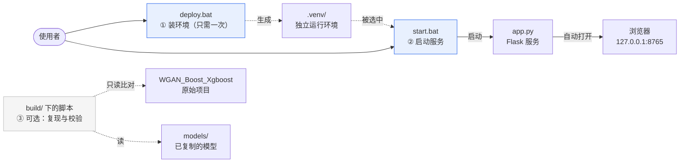
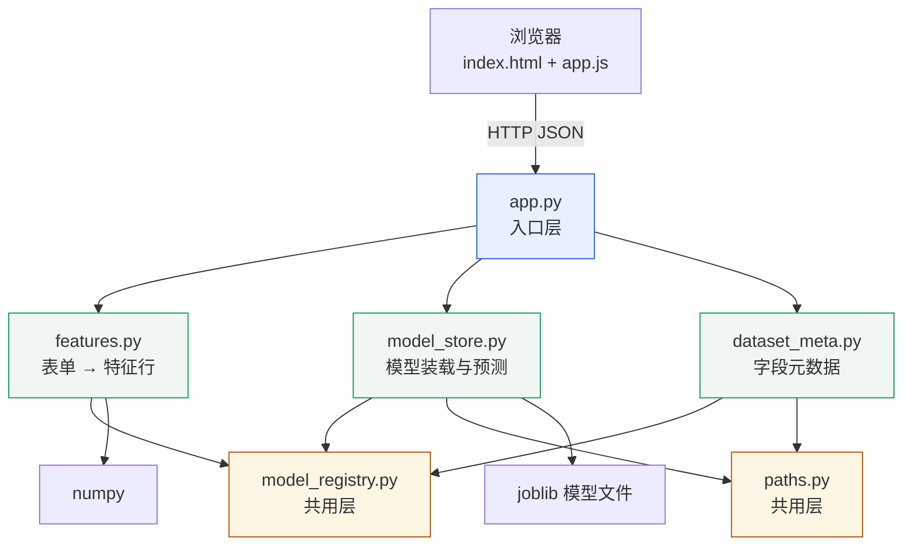
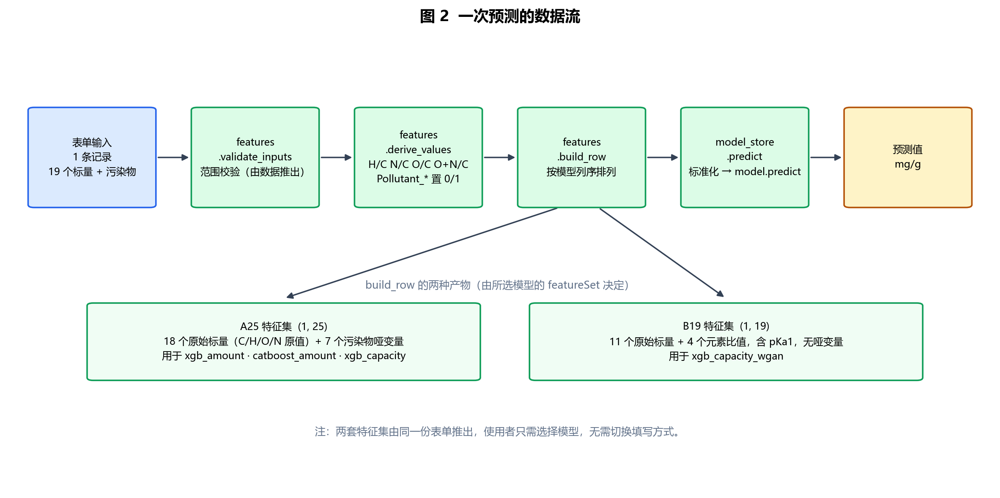
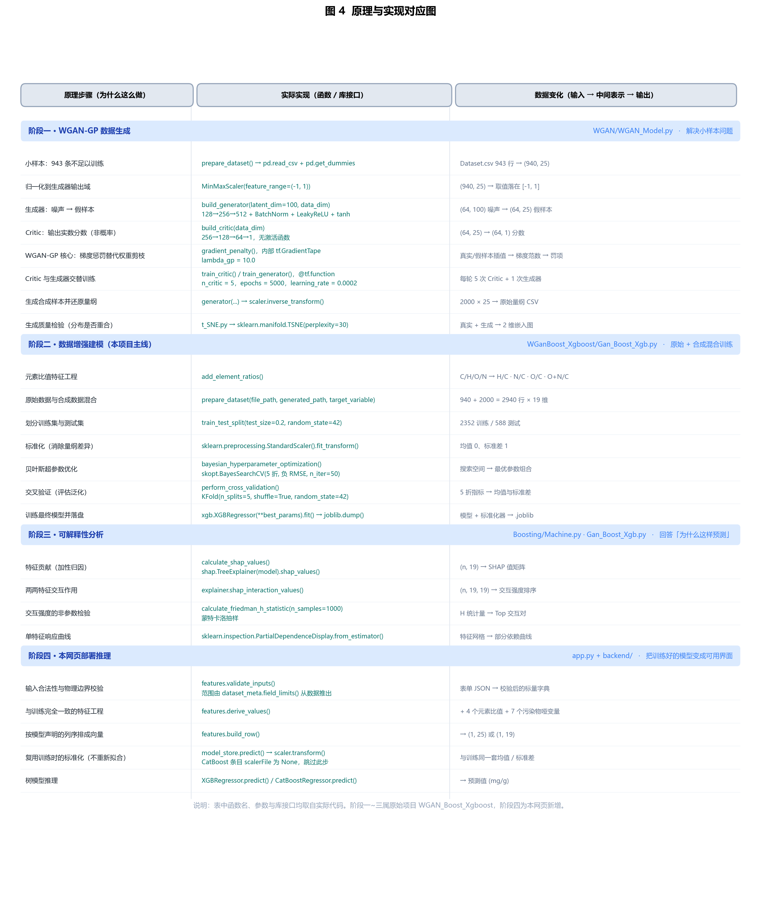

# 生物炭吸附性能预测器

磺胺类抗生素在生物炭上吸附性能的**本地网页预测器**：浏览器负责界面交互，Python 服务负责模型调用。

用下拉框选定污染物、填写生物炭性质与吸附条件，即可预测**吸附量**或**吸附容量**，并同时看到该项目训练过的多个模型在同一输入下的结果对比。

- 数据来源：`WGAN_Boost_Xgboost` 项目（943 条文献整理的吸附实验记录 × 25 列）
- 模型来源：该项目已训练好的 XGBoost / CatBoost 模型，**未重新训练**
- 运行方式：本机 Python 服务 + 浏览器，不联网、不上传任何数据

---

## 一、快速开始

### 首次使用：先部署环境（换机器或没有依赖时）

**Windows 双击运行：**

```
deploy.bat
```

它会在**项目根目录**创建虚拟环境 `.venv` 并安装依赖，全过程只用标准库，因此在依赖尚未安装时也能跑起来。
完成后 `start.bat` 会自动优先使用这个环境，**不需要手动激活**。

部署脚本的配置都在 `deploy.json` 里：

| 配置项 | 作用 |
|---|---|
| `venvDir` | 虚拟环境目录名（默认 `.venv`） |
| `pythonExe` | 用哪个 Python 创建环境；**留空 = 自动挑选**（见下） |
| `pinnedVersions` | **锁定版本**，默认锁定为本项目验证过的组合；置为 `{}` 则改用 `requirements.txt` 装最新版 |
| `pipIndexUrl` | pip 源，默认清华镜像 |
| `verifyImports` | 安装后逐个 `import` 验证 |
| `checkBackend` | 是否额外验证本项目后端模块与 `models/` 齐备 |

常用参数：

```bat
deploy.bat --dry-run                        :: 只打印将执行的命令，不改动任何文件
deploy.bat --no-pin                         :: 忽略锁定版本，直接按 requirements.txt 装
deploy.bat --recreate                       :: 已有环境也删除重建
deploy.bat --index-url https://pypi.org/simple
deploy.bat --venv-dir .venv-test
```

> `deploy.bat` 只调用 `deploy.py`，`deploy.py` 只读 `deploy.json`——三个文件构成一套独立的最小部署单元。
> 默认锁定版本，是为了复现本项目验证过的组合（见第七节），而不是装到当时的最新版。

**基础解释器是自动挑的，不写死在 `.bat` 里。** `deploy.bat` 只负责找到一个能运行
`deploy.py` 的 Python（脚本只用标准库，任何 3.9+ 都行），真正选谁由 `deploy.py` 决定：

```
搜索顺序：运行本脚本的解释器 → 环境变量 PYTHON → conda 环境 tf
          → py 启动器注册的其它版本（从高到低）→ PATH 上的 python

选择规则：优先取「版本 ≤ 锁定版本验证上限 3.12」的第一个候选，
          因为更新的 Python 未必有锁定版本的预编译 wheel。
```

这样做是因为实测踩到过一个坑：`.bat` 里写 `py` 会解析到本机默认的 **Python 3.14**，
而 3.14 上 `numpy==2.2.6` 没有 wheel，会一路降级安装最新版，
再撞上本机应用控制策略拦截新版 sklearn 的 DLL——**双击一次装出一个跑不起来的环境**。
把挑选逻辑放到 Python 里之后，同一台机器上会正确选中 3.10 的解释器。

**实测数据**（以本机 conda 环境 `tf` 作基础解释器）：

| 指标 | 值 |
|---|---|
| 耗时 | 63 秒 |
| 磁盘占用 | 约 880 MB（其中 xgboost 与 catboost 各约 100 MB） |
| 基础解释器 | Python 3.10.21 |

**装不上时脚本会自动降级，而不是直接报错终止。** 按顺序尝试，每步都说明为什么换下一种：

```
① 按 deploy.json 锁定版本安装         ← 可复现验证过的组合
② 改为不锁版本（按 requirements.txt）  ← 精确版本在当前 Python 上没有 wheel 时
③ 换官方 PyPI 源安装                  ← 镜像缺包或源故障时
```

第 ② 步不是"重试"，而是换目标：锁定版本只在 Python 3.10 ~ 3.12 上验证过，
更新的 Python 未必有对应 wheel。**实测 Python 3.14 上 `numpy==2.2.6` 确实没有 wheel**
（其余 5 个包都有）——这种情况脚本会降级安装，并在输出里明确告知
「本次没能锁定版本，与第七节记录的版本组合可能有细微差异」。

想避免降级，用 Python 3.10 ~ 3.12 作基础解释器即可，
也可以在 `deploy.json` 里把 `pythonExe` 指向一个已知可用的解释器。

`requirements.txt` 里的依赖都写了主版本上界（如 `pandas>=1.3.0,<3.0.0`），
就是为了让"不锁版本"这条降级路径落在兼容的主版本内——不带锁版本的安装实测会取到
`pandas 3.0.6`、`scikit-learn 1.9.1` 这类跨大版本的组合。

### 启动服务

**Windows 双击运行：**

```
start.bat
```

脚本会自动寻找可用的 Python 解释器（依次尝试环境变量 `PYTHON`、项目内 `.venv`、
用户目录下的 `conda` 环境 `tf`、`PATH` 上的 `python`），
并**实际验证依赖能否 import** 后才启动，随后自动打开浏览器。

> 候选列表里**不含任何他人机器的绝对路径**。要加自己的解释器，设 `PYTHON` 环境变量，
> 或在 `start.bat` 的候选区追加一行 `call :try "你的路径"`。

**命令行运行：**

```bat
python app.py
python app.py --port 8766        :: 换端口
python app.py --no-browser       :: 不自动开浏览器
```

服务启动后访问 <http://127.0.0.1:8765/>。

---

## 二、界面能做什么

| 功能 | 说明 |
|---|---|
| 预测目标切换 | 吸附量 Adsorption amount / 吸附容量 Adsorption capacity |
| 模型选择 | 卡片式列出该目标下可用模型，显示各自测试集 R² / RMSE，默认选中精度最高者 |
| 污染物选择 | 7 种磺胺类抗生素；选中后 **MW、Kow、pKa1、E、S、A、B、V 八个分子描述符自动带出**（已核对：这些描述符在数据集中对每种污染物唯一确定） |
| 填写辅助 | 「填充典型值」按数据集中位数补空；每个字段下方标注数据集实际范围 |
| 多模型对比 | 一次预测同时给出该目标下全部模型的结果与极差，直接体现模型横向比较 |
| 真实记录对照 | 点选示例一键载入一条真实实验记录，界面同时显示**实测值**与**偏差** |
| 输入明细 | 可展开查看模型实际收到的特征向量（含推导出的元素比值与哑变量） |
| 一键演示 | 地址加 `?autorun=1` 自动载入示例并预测，可加 `&target=capacity&sample=Sulfapyridine` |

**实际运行截图**

吸附量预测（CatBoost 胜出，与实测值偏差 +1.357 mg/g）：



吸附容量预测（XGBoost 与 WGAN-GP 增强模型对比，偏差 +0.224 mg/g）：



两张截图均由无头浏览器实际渲染所得，可用第九节验证 5 的命令复现。

---

## 三、目录结构



下图与上面这张图对应，便于复制路径：

```
Adsorption_Predictor_Web/
├── deploy.bat                      # 一键部署：调用 deploy.py
├── deploy.py                       # 部署脚本：建虚拟环境 + 装依赖（仅标准库）
├── deploy.json                     # 部署配置：环境目录、锁定版本、pip 源
├── start.bat                       # 启动器（解释器候选链 + 依赖自检）
├── app.py                          # 入口层：Flask 路由与编排
├── requirements.txt
├── README.md
├── .gitignore
│
├── backend/                        # 服务端分层
│   ├── __init__.py
│   ├── paths.py                    # 共用层：路径地址簿（纯常量）
│   ├── model_registry.py           # 共用层：模型清单、特征集定义、边界常量
│   ├── features.py                 # 功能层：表单 → 特征行
│   ├── model_store.py              # 功能层：模型装载与预测
│   └── dataset_meta.py             # 功能层：字段元数据与取值范围
│
├── frontend/                       # 浏览器端（只做界面，不做数值计算）
│   ├── index.html
│   ├── style.css
│   ├── app.js
│   ├── field_meta.json             # 字段元数据（离线生成）
│   └── samples.json                # 示例记录（离线生成）
│
├── models/                         # 模型与数据（自包含，换机器可用）
│   ├── xgb_amount.joblib
│   ├── scaler_amount.joblib
│   ├── catboost_amount.joblib
│   ├── xgb_capacity.joblib
│   ├── scaler_capacity.joblib
│   ├── xgb_capacity_wgan.joblib
│   ├── scaler_capacity_wgan.joblib
│   └── Dataset.csv
│
├── docs/                           # 交付附件（可直接放进报告）
│   ├── figures/                    # 四张 PNG 图：架构 / 数据流 / 完整结构 / 原理对应
│   └── screenshots/                # 网页实际运行截图
│
└── build/                          # 离线构建与校验脚本（不参与运行）
    ├── source_project.py           # 原项目路径定位（不写死开发机绝对路径）
    ├── make_field_meta.py          # 生成 field_meta.json
    ├── make_samples.py             # 生成 samples.json
    ├── make_architecture_figure.py # 生成 docs/figures/ 下的四张图
    ├── measure_wgan_model.py       # 复算 WGAN 增强模型的测试集指标
    ├── verify_models.py            # 校验模型副本与原件一致
    ├── reproduce_metrics.py        # 复算指标，核对跨版本行为是否漂移
    ├── test_api.py                 # 接口端到端测试
    └── self_check.py               # 交付前总自检（串起以上全部）
```

### 关于 `build/` 脚本里的原项目路径

`build/` 下的校验脚本要读取 `WGAN_Boost_Xgboost` 原项目的模型与结果文件做比对。
这个路径**不写死**，由 `build/source_project.py` 按以下顺序定位：

```
① 环境变量 SOURCE_PROJECT
② 本交付物的同级目录（推荐：两个文件夹并排放在一起）
③ 用户桌面下的同名目录
```

找不到时会列出所有尝试过的位置并给出三种解决办法。
校验脚本属于可选的复现工具——**运行网页本身不需要原项目**，
因为模型已经复制进 `models/` 了。

---

## 四、代码结构与调用树

> 下面两张图是 **PNG**，可直接插入 Word 报告（Mermaid 在 Word 里不渲染）。
> 由 `build/make_architecture_figure.py` 生成，图上的模块名与代码严格一致。



### 4.1 三个入口，各管一件事

整个项目对外只有三个可双击的入口，职责互不重叠：



| 入口 | 何时用 | 做了什么 |
|---|---|---|
| `deploy.bat` | 首次 / 换机器 | 建 `.venv` 并装依赖，约 40 秒 |
| `start.bat` | 每次要用 | 找可用解释器 → 起 Flask → 开浏览器 |
| `build/*.py` | 可选，验证或换模型时 | 复算指标、比对模型副本；**运行网页不需要它们** |

### 4.2 运行期架构（分层）

分层遵循「入口 → 功能 → 共用 → 标准库」单向依赖，**功能层模块之间不互相 import**。



### 4.3 服务端调用树（`app.py`）

```
main (app.py)
├── model_store.warm_up                    只执行一次，预装载 4 个模型
├── open_browser                           只执行一次
└── app.run                                进入请求循环，以下由 Flask 框架调用
    │
    ├── [GET /api/meta]      api_meta
    │   ├── dataset_meta.load_field_meta
    │   ├── dataset_meta.field_limits
    │   ├── dataset_meta.typical_values
    │   ├── dataset_meta.load_samples
    │   └── dataset_meta.descriptor_is_constant
    │
    ├── [POST /api/predict]  api_predict
    │   ├── features.build_row
    │   │   ├── features.validate_inputs
    │   │   └── features.derive_values
    │   ├── model_store.predict
    │   │   └── model_store.load_model        首次装载后走缓存
    │   └── features.describe_feature_row
    │
    ├── [POST /api/compare]  api_compare
    │   └── （逐模型）features.build_row → model_store.predict
    │
    └── [GET /api/health]    api_health → model_store.loaded_keys
```

### 4.4 浏览器端调用树（`app.js`）

```
init
├── bindEvents
└── loadMeta
    ├── renderTargetSwitch
    ├── renderModelList
    ├── renderPollutantSelect
    ├── renderFieldGroups
    ├── renderSamples
    ├── selectDefaultModel
    └── handleAutorun                    仅当地址带 ?autorun=1
        ├── loadSample
        └── runPrediction
            ├── collectInputs
            ├── requestPrediction        → POST /api/predict
            ├── requestComparison        → POST /api/compare
            └── renderResult
                ├── renderPrediction
                ├── renderTruthCompare
                ├── renderCompareTable
                └── renderFeatureRow
```

### 4.5 部署脚本调用树（`deploy.py`）

```
main
├── load_config                读 deploy.json + 套用命令行覆盖
├── select_base_python         搜索并挑选与锁定版本兼容的解释器
│   ├── discover_candidates
│   │   └── _parse_py_launcher     解析 `py -0p` 的已注册版本
│   └── probe_python               逐个探测版本，不可用则跳过
├── ensure_venv                创建或复用 .venv
├── install_dependencies       三级降级链安装
│   ├── build_install_strategies
│   └── pip_command → run_command  实时透传 pip 输出
├── verify_imports             逐个 import 验证
├── check_backend              验证 backend 模块与 models/ 齐备
└── report                     输出后续操作指引
```

### 4.6 校验脚本调用树（`build/`）

`self_check.py` 是唯一的编排者，其余脚本各自独立、可单独运行：

```
self_check.py  main
├── check_syntax                    扫描项目自身 .py 的可解析性
├── check_required_files            关键文件齐备性
├── check_limits_consistency        后端范围 ↔ /api/meta 下发值
├── call_script → verify_models.py      副本 vs 原件预测比对
├── call_script → reproduce_metrics.py  指标复算与跨版本行为
├── call_script → test_api.py           接口端到端数值校验
└── check_deploy_script             deploy.py --dry-run 演练

各脚本共用的定位模块（其余脚本各自独立调用它，彼此之间不互相调用）：
source_project.py
├── candidate_paths                 列出候选位置
└── find_source_project             环境变量 → 同级目录 → 用户桌面
```

### 4.7 浏览器端结构

**零框架、零构建。** 没有 npm、没有打包步骤、没有 `node_modules`，
总共 5 个文件 54 KB，改完刷新页面即生效。

```
frontend/                     角色
├── index.html    3.9 KB      骨架：只有容器与 id，不含具体字段
├── style.css     9.2 KB      样式：6 个分区（变量 / 页头页脚 / 布局 / 表单 / 结果 / 响应式）
├── app.js       20.3 KB      逻辑：5 个分区
├── field_meta.json  10.2 KB  字段元数据（离线生成）
└── samples.json      4.8 KB  示例记录（离线生成）
```

> 两个 JSON 由 `build/` 脚本离线生成，**由 Python 读取后经 `/api/meta` 下发**，
> 浏览器并不直接读它们（放在 `frontend/` 下只是因为 Flask 把它整个当静态目录，
> 顺手可以直接打开 `http://127.0.0.1:8765/field_meta.json` 查看内容）。

`app.js` 的五个分区：

| 分区 | 行数范围 | 职责 |
|---|---|---|
| ① 状态与工具 | L45–77 | 全局 `META`、`state`、DOM 取值/创建/格式化工具 |
| ② 元数据渲染 | L79–303 | 拉 `/api/meta`，据此**生成**表单、模型卡片、示例按钮 |
| ③ 表单行为 | L305–380 | 污染物联动描述符、填充典型值、重置、载入示例、收集输入 |
| ④ 预测与渲染 | L382–562 | 调 `/api/predict` 与 `/api/compare`，画结果、对比表、特征明细 |
| ⑤ 入口 | L564–578 | `bindEvents` + `init`，绑定在 `DOMContentLoaded` |

DOM 骨架（左右两栏，CSS Grid）：

```
.site-header                    标题 + 数据集信息
.layout  ── CSS Grid 两栏 ──────────────────────────────────┐
├── #form-panel    左栏：输入                                │
│   ├── #target-switch      目标切换        ← JS 渲染         │
│   ├── #model-list         模型卡片        ← JS 渲染         │
│   ├── #pollutant-select   污染物下拉      ← JS 填充 option  │
│   ├── #dynamic-groups     动态字段区      ← JS 按元数据生成 │
│   ├── #predict-btn / #typical-btn / #reset-btn             │
│   └── #sample-list        示例按钮        ← JS 渲染         │
└── #result-panel  右栏：结果                                │
    ├── #result-placeholder 初始占位（有结果后隐藏）          │
    ├── #result-body        结果主体（初始隐藏）              │
    │   ├── .prediction-card   大号预测值                     │
    │   ├── #truth-compare     与实测值对照                   │
    │   ├── #compare-table     多模型对比表                   │
    │   ├── #feature-row       模型实际收到的特征（折叠）      │
    │   └── #model-note        模型说明                       │
    └── #error-box          错误提示（默认隐藏）              │
.site-footer                    来源说明
```

**两个结构性决定：**

1. **表单字段不写死在 HTML 里**，由 JS 按 `/api/meta` 的字段元数据动态生成。
   往表单加一个输入项只需改 `model_registry.py` 与元数据，HTML 一行都不用动。
2. **浏览器端零数值计算**：`app.js` 里只有 `Number()` 转换和 `toFixed()` 显示，
   元素比值、独热编码、标准化、模型推理全在 Python 侧。

**一次预测的请求时序**（两个接口**并行**，对比表不拖慢主结果）：

```
DOMContentLoaded → init → bindEvents + loadMeta
                              └── fetch /api/meta  → 渲染全部表单与卡片

点击「开始预测」→ runPrediction
    ├── collectInputs                      读 DOM，做非空/数字校验
    └── Promise.all([ ... ])               两个请求同时发出
            ├── requestPrediction  → POST /api/predict   当前选中的模型
            └── requestComparison  → POST /api/compare   该目标下全部模型
                    ↓
            renderResult
                ├── renderPrediction      大号预测值 + 口径与出处
                ├── renderTruthCompare    载入示例时才显示实测偏差
                ├── renderCompareTable    多模型对比（口径不同会给出提示）
                └── renderFeatureRow      展开可见特征明细
```

---

## 五、输入数据结构与形状



用户填写的是一行"实验条件"，服务端把它转成模型要吃的向量。两套特征集由**同一份表单**推出。

```
用户表单（1 条记录）
├── Pollutant            类别    7 选 1
├── 生物炭性质            7 个标量  SBET, VTotal, Dp, C, H, O, N
├── 吸附条件              4 个标量  Dosage, Initial concentration, Temperature, Initial pH
└── 分子描述符            8 个标量  MW, Kow, pKa1, E, S, A, B, V   ← 随污染物自动带出
                                    │
                    features.derive_values 推导
                                    │
        ┌───────────────────────────┴───────────────────────────┐
        ▼                                                       ▼
  A25 特征集 (1, 25) float64                        B19 特征集 (1, 19) float64
  ├─ 18 个原始标量（含 pKa1 被剔除）                 ├─ 11 个原始标量
  └─ 7 个污染物哑变量 Pollutant_*                    └─ 4 个元素比值 H/C, N/C, O/C, O+N/C
      （0/1，仅选中项为 1）                              └─ 含 pKa1，无哑变量
        │                                                       │
        ▼                                                       ▼
  StandardScaler.transform                        StandardScaler.transform
  → (1, 25) 标准化后                                → (1, 19) 标准化后
        │                                                       │
        ▼                                                       ▼
  XGBoost ← 吃标准化后                          XGBoost ← 吃标准化后
  CatBoost ← 吃**原始**特征（未标准化）          预测值 (mg/g)

  各模型条目中的 scalerFile 为 null 时跳过 transform —— CatBoost 即属此类
```

**目标变量**：`Adsorption amount`（吸附量，mg/g）与 `Adsorption capacity`（吸附容量，mg/g），取自数据集同名列。

---

## 六、原理步骤与实现的对应



下面这张表是上图的文字版，便于检索具体接口：

| 原理步骤 | 实际实现 | 说明 |
|---|---|---|
| 原始实验记录 → 建模输入 | `build/make_field_meta.py` 统计 → `field_meta.json` | 离线完成，运行期不重算 |
| 污染物类别 → 数值向量 | `features.derive_values` 中 `Pollutant_*` 置 0/1 | 与训练时 `pd.get_dummies` 展开的 7 列一致 |
| 元素组成 → 元素比值 | `features.derive_values` 计算 `H/C, N/C, O/C, O+N/C` | 与 `WGanBoost_Xgboost/Gan_Boost_Xgb.py: add_element_ratios` 同式 |
| 特征标准化 | `sklearn.preprocessing.StandardScaler.transform`，由 `model_store.predict` 调用 | 均值/方差是训练时保存的对象，不重新拟合 |
| 树模型推理 | `xgboost.XGBRegressor.predict` / `catboost.CatBoostRegressor.predict` | 直接调用原库，不做任何数值近似 |
| 输入合法性检查 | `features.validate_inputs` | 范围来自数据统计，见第八节 |
| 多模型横向比较 | `api_compare` 逐模型调用同一个 `predict` 流程 | 保证比较口径一致 |

**为什么不需要重新训练**：`models/` 中是原项目训练好的 joblib 对象，服务只做装载与调用。
`build/verify_models.py` 已验证副本与原件预测完全一致（见第九节）。

---

## 七、模型清单与精度

四个模型，指标均可追溯到原项目的落盘记录。**注意评估口径不同，R² 不宜直接横比**，
页面上也显式列出了每个模型的口径。

| 目标 | 模型 | 特征集 | 评估口径 | R² | RMSE (mg/g) | 指标出处 |
|---|---|---|---|---|---|---|
| 吸附量 | XGBoost（贝叶斯调参） | 25 维 | 5 折交叉验证 | 0.9669 | 19.83 | 原项目 `README.md` |
| 吸附量 | **CatBoost（贝叶斯调参）** | 25 维 | 80/20 留出测试集 | **0.9619** | **15.70** | `results/lightgbm_catboost/result_adsorption_amount.txt` |
| 吸附容量 | XGBoost（贝叶斯调参） | 25 维 | 5 折交叉验证 | 0.9756 | 20.40 | `results/Adsorption_capacity/result.txt` 的 `cv_metrics` |
| 吸附容量 | XGBoost + WGAN-GP 增强 | 19 维 | 80/20 留出测试集 | 0.9614 | 25.90 | **本项目复算**，`build/measure_wgan_model.py` |

### 指标核对过程中修正的一处错误

初版把两个 XGBoost 模型的精度写成了 0.9281 / 0.9902，**这是错的**。原因是原项目
`Boosting/Machine.py` 里同时存在两个 XGBoost：

| 变量 | 用途 | 是否落盘 |
|---|---|---|
| `train_tree_models()` 内 200 棵树、固定超参的模型 | **六模型横向对比**，README 表格里的 0.9281 / 0.9902 属于它 | 存为 `xgboost_model.joblib` |
| `final_xgb_model`（贝叶斯调参后重新拟合） | 真正被 `joblib.dump` 成 `xgboost_model_<目标>.joblib` | **就是本网页部署的那个** |

`build/reproduce_metrics.py` 用多个随机种子复现划分后，发现复算值明显高于 0.9281，
顺藤摸瓜定位到这里。修正后复算值与展示值吻合：

| 模型 | 页面展示 R² | 复算 R²（7 个种子的区间中心） | 偏差 |
|---|---|---|---|
| XGBoost（吸附量） | 0.9669 | 0.9730 | +0.0061 |
| CatBoost（吸附量） | 0.9619 | 0.9727 | +0.0108 |
| XGBoost（吸附容量） | 0.9756 | 0.9866 | +0.0110 |

偏差来自原预处理未固定随机种子（随机抽 3 条作验证集），属正常波动。

### 默认选中哪个模型

页面**不按 R² 取最大值来选默认模型**——各模型口径不同，比大小会误导。
默认模型由 `backend/model_registry.py` 的 `isDefault` 字段显式声明：

| 目标 | 默认模型 | 理由 |
|---|---|---|
| 吸附量 | CatBoost | 原项目 README 的结论是「CatBoost 为当前全场最优模型」 |
| 吸附容量 | XGBoost | 该目标下没有 CatBoost 对照，用调参后的 XGBoost |

对比表格同样保持注册表顺序、不按 R² 重排，并在口径不一致时给出提示文字。

### 关于跨版本装载

XGBoost 装载旧版本序列化的模型时会打印警告，提示"保存"与"序列化"存在差异。
本项目用 `xgboost 3.2.0` 装载 `1.7.6` 训练的模型，上表的复算结果说明
**预测行为没有漂移**：三个模型的复算 R² 都落在展示值附近，且方向一致（略高），
而非出现量级偏差。

### 关于 WGAN 增强模型的指标

原项目训练脚本只把该模型指标打印到控制台，没有落盘。
`build/measure_wgan_model.py` 按其随机种子（42）复现了同一套数据划分，
并断言复现出的 `StandardScaler` 的均值与标准差和保存值**差值恰为 0**，
据此确认划分忠实还原后，重新算出上表指标。

---

## 八、输入取值范围怎么来的

`features.validate_inputs` 用到的上下界**不是写死的常量**，而是由 `dataset_meta.field_limits()`
从 `field_meta.json` 的实测范围向外放宽 50% 得到，再与物理边界取交集：

```
下界 = 数据 min − 0.5 × (max − min)
上界 = 数据 max + 0.5 × (max − min)
      ↓ 修正
· 非负字段（SBET、Dp、Dosage、C…）下界抬到 0
· 有定义域的字段取交集：pH ∈ [0, 14]、温度 ∈ [200, 400] K、C > 0
```

例如平均孔径 Dp：数据实际 1.02 ~ 256.4 nm → 可接受区间 0 ~ 384.1 nm。

**这里踩过一个坑**：初版把每个字段的上下界写成手写常量，`Dp` 上界误写为 100，
而数据实际到 256.4 —— 结果是**全部真实实验记录都会被判为越界**。
`build/verify_models.py` 抽样 200 条真实记录时立刻暴露了这个问题。
改为从数据推导后，常量与数据集不会再脱节。

---

## 九、验证记录

以下验证均已实际执行，命令与结果如实记录。

| # | 验证内容 | 命令 | 结果 |
|---|---|---|---|
| 1 | 模型副本完整性 | `python build/verify_models.py` | 4 个模型 × 200 条真实记录，**最大偏差 0**，复制无损 |
| 2 | 指标一致性与跨版本行为 | `python build/reproduce_metrics.py` | 3 个模型复算值与展示值吻合（偏差 +0.006 ~ +0.011），新版库无行为漂移 |
| 3 | 接口数值正确性 | `python build/test_api.py` | 28 次预测与直连 `model.predict` **偏差 0** |
| 4 | 接口异常路径 | 同上 | 5 类非法输入（污染物非法 / 字段缺失 / 数值越界 / 非数字 / 模型不存在）全部返回 400 与可读原因 |
| 5 | WGAN 模型指标复算 | `python build/measure_wgan_model.py` | 复现 scaler 与保存值差值 0，R² = 0.9614 |
| 6 | 一键部署脚本 | `deploy.bat` 真实执行一遍 | Python 3.10 下成功：63 秒建出 `.venv`、装上全部锁定版本、导入验证通过；`start.bat` 随后自动选中该环境 |
| 7 | 部署降级链 | 用 Python 3.14 实跑 | 锁定版本因 `numpy==2.2.6` 无 cp314 wheel 而失败 → 自动改按 `requirements.txt` 装成功并明确告知未锁版本 |
| 8 | 启动器端到端 | 双击 `start.bat` | 正确跳过缺失的解释器候选、优先选中 `.venv`、4 个模型装载、页面 200 |
| 9 | 页面真实渲染 | 无头 Edge 截图 | 表单、模型卡片、预测值、实测对照、对比表均正确渲染 |
| 10 | 交付前总自检 | `python build/self_check.py` | 语法、文件齐备性、范围一致性、模型完整性、指标、接口、部署脚本 7 组检查全部通过 |

第 10 项是提交前建议重跑的一条命令；其中第 6 项需要服务正在运行
（`python app.py --no-browser`）。

**第 7 项的一个附带发现（与项目无关，但会影响本机使用）**：
用 Python 3.14 建出的环境里，`sklearn` 导入时报
`ImportError: DLL load failed ... 应用程序控制策略已阻止此文件`。
这是**本机 Windows 应用控制策略**在拦截新下载的动态库，不是项目或脚本的问题——
同一次运行中脚本已正确识别并报错退出，没有假装成功。
若在别的机器上遇到同样提示，需要用 Python 3.10 ~ 3.12，
或请管理员为该环境目录放行。

第 5 项对应 `?autorun=1` 链路，可自行复现：

```bat
msedge --headless=new --screenshot=shot.png --window-size=1400,1500 ^
       --virtual-time-budget=10000 "http://127.0.0.1:8765/?autorun=1"
```

**未执行的验证**：未在 Firefox / Safari 上测试；未做并发压力测试；
未验证 `models/` 之外的原项目其他模型（LightGBM、RandomForest、SVM、ANN 等未纳入本网页）。

---

## 十、环境与依赖

| 项 | 值 |
|---|---|
| 开发与验证环境 | conda 环境 `tf`（Python 3.10.21） |
| 操作系统 | Windows 10 / 11 x64 |
| 硬件 | 仅 CPU 即可（本服务不做训练） |

```
flask>=3.0.0      joblib>=1.2.0     numpy>=1.20.0     pandas>=1.3.0
scikit-learn>=1.0.0   xgboost>=1.5.0   catboost>=1.2.0
```

实测版本：`numpy 2.2.6` / `pandas 2.3.3` / `scikit-learn 1.7.2` / `xgboost 3.2.0` /
`catboost 1.2.10` / `joblib 1.6.0` / `flask 3.1.3`，详见 `requirements.txt`。

> 训练该项目时用的是 xgboost 1.7.6；本服务用 3.2.0 装载旧版模型已验证可用，
> 预测值与原件逐位一致（第九节验证 1）。

---

## 十一、接口说明

| 方法 | 路径 | 用途 |
|---|---|---|
| GET | `/` | 单页界面 |
| GET | `/api/meta` | 表单与模型元信息、字段范围、污染物描述符、示例样本 |
| POST | `/api/predict` | 指定模型做单条预测 |
| POST | `/api/compare` | 同一输入下该目标全部模型的预测与极差 |
| GET | `/api/health` | 各模型是否已成功装载 |

**请求示例**

```json
POST /api/predict
{
  "modelKey": "catboost_amount",
  "inputs": {
    "Pollutant": "Sulfadiazine",
    "SBET": 832, "VTotal": 0.563, "Dp": 2.7067,
    "C": 51.99, "H": 3.62, "O": 42.51, "N": 0.97,
    "Dosage": 0.1, "Initial concentration": 5,
    "Temperature": 298, "Initial pH": 6.9
  }
}
```

分子描述符（MW、Kow、pKa1、E、S、A、B、V）在页面上会自动带出；
直接调接口时需一并给出这 8 个字段。

**响应示例**

```json
{
  "ok": true,
  "modelLabel": "CatBoost",
  "targetLabel": "吸附量 Adsorption amount",
  "unit": "mg/g",
  "prediction": 40.780,
  "standardized": false,
  "metrics": { "r2": 0.9619, "rmse": 15.7,
               "source": "WGAN_Boost_Xgboost/results/lightgbm_catboost/result_adsorption_amount.txt" },
  "featureRow": [ { "name": "SBET", "value": 832.0 }, ... ]
}
```

---

## 十二、已知限制

- **适用域**：模型只在磺胺类抗生素 + 生物炭这一数据集上训练。超出表中所列污染物、
  或把输入填到数据范围之外（服务会拦下明显越界值，但范围内外推仍有风险），预测不可信。
- **不做训练**：本服务只装载已有模型；若要换模型或重训，需回到 `WGAN_Boost_Xgboost` 项目，
  再把新的 `.joblib` 放进 `models/` 并更新 `backend/model_registry.py`。
- **未做数据泄露复核**：`WGAN_Boost_Xgboost` 的验证集为随机抽 3 条，
  且其在 WGAN 增强模型上使用全量 `X` 做贝叶斯搜索后再取 80/20 划分，
  严格来说存在轻微的信息泄露；本网页如实沿用原项目口径，未作改动。
- **单机单用户**：Flask 开发服务器，未做鉴权与并发优化，仅建议本机使用。
- **模型副本是训练时产物**：`models/` 中的 `Dataset.csv` 供对照与复算使用，运行期只读取元数据 JSON。
