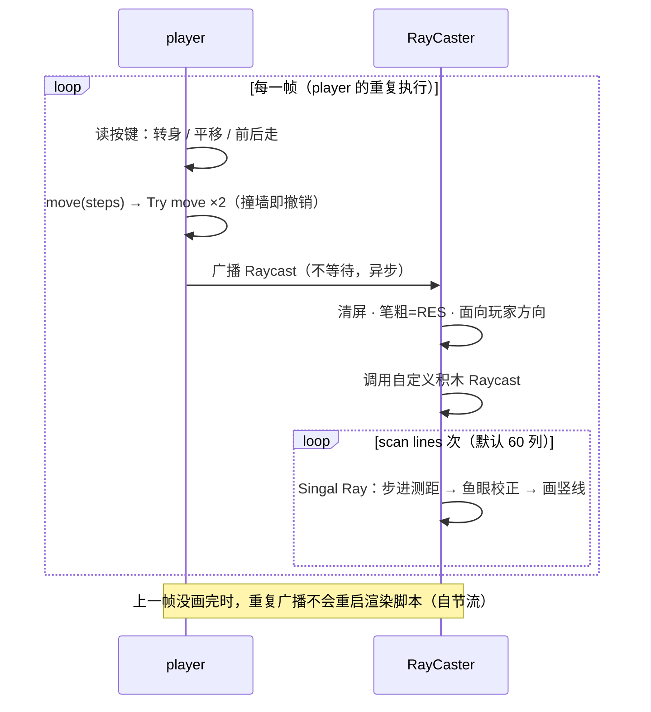

# Scratch 3D · 光线投射引擎 — 代码结构与调用关系

纯 Scratch 画笔实现的伪 3D 第一人称渲染（Wolfenstein 3D 风格）：没有贴图、没有扩展，画面由 60 根射线逐列画出。本文档讲清楚三件事：**谁负责什么、谁调用谁、数据怎么流动**。算法公式集中在 §6。

## 目录

1. [运行与操作](#1-运行与操作)
2. [文件结构](#2-文件结构)
3. [角色与脚本总览](#3-角色与脚本总览)
4. [调用关系](#4-调用关系)
5. [变量与数据流](#5-变量与数据流)
6. [核心算法速览](#6-核心算法速览)
7. [地图](#7-地图)
8. [已知问题与调优](#8-已知问题与调优)

## 1. 运行与操作

用 Scratch 3 编辑器打开 `Scratch 3D.sb3`，点击绿旗。

| 按键 | 动作 |
|:---:|:---|
| `W` / `↑` | 前进 2 步 |
| `S` / `↓` | 后退 2 步 |
| `A` / `D` | 左 / 右平移（先转 90° → 前进 → 转回，借用前进逻辑） |
| `←` / `→` | 平移 2 步 + 转身 15° |

## 2. 文件结构

`.sb3` 本质是 ZIP 包，核心是 `project.json`（角色、脚本、变量全在里面），其余为按 md5 命名的素材：

```
Scratch 3D.sb3
├── project.json                 所有角色 / 脚本 / 变量的定义
└── 素材（按内容 md5 命名）
    ├── 685b7d0c….svg   level 造型         碰撞地图（灰 #808080，484×361）
    ├── 6957009f….svg   level color 造型   同一地图的两份偏移副本：(1,0) 与 (5,1)
    ├── dafb1439….svg   player 造型        黄绿箭头（11×23px，实际全程隐身）
    ├── e1fff788….png   hitbox             8×8 位图 @2x → 屏幕上 4×4 像素
    ├── 0897bfc4….svg   舞台背景 2         天花板/地板渐变（当前使用）
    ├── 38b1374b….png   舞台背景 1         备用背景（未使用）
    └── 83a9787d….wav   pop 音效           两个角色共用的默认音效
```

## 3. 角色与脚本总览

| 角色 | 造型 | 脚本入口 | 职责 |
|------|------|---------|------|
| Stage | 渐变背景 ×2 | — | 存全局变量；背景即"天花板+地板"（地平线处黑） |
| `level` | 碰撞地图 | 1（绿旗） | 隐身，只作为碰撞体 |
| `level color` | 双份偏移地图 | 1（绿旗） | 隐身，只用于墙面颜色判定 |
| `player` | 箭头 + hitbox | 3（绿旗 + 2 个自定义积木） | 键盘输入、分轴碰撞移动、每帧广播触发渲染 |
| `RayCaster` | hitbox | 4（绿旗 + 广播接收 + 2 个自定义积木） | 发射射线、逐列画竖线 |

`level`、`level color`、`player`、`RayCaster` 四个角色全程幽灵 100% 隐身——它们只是逻辑实体，观众看到的一切都由画笔画出。

## 4. 调用关系

### 4.1 启动时（绿旗，4 条脚本并行）

```
🚩 绿旗被点击
 ├─ level        : 移到 (0,0) → 幽灵 100（隐身，只留碰撞体）
 ├─ level color  : 移到 (0,0) → 幽灵 100（隐身，只留判定体）
 ├─ player       : 移到 (0,10)、面向 45°、隐身 → 进入主循环（见 4.2）
 └─ RayCaster    : FOV=60、RES=8、切 hitbox 造型、不旋转、隐身待命
```

### 4.2 每帧调用链

```
player「重复执行」（每圈 ≈ 一帧）
 │
 ├─ 读按键：←/→ 转身 15°；W/S → move(±2)；A/D → 转向 90° 后 move(2) 再转回
 │
 │    move(steps)                          ← 自定义积木
 │     ├─ 切 hitbox 造型（4×4px 判定盒）、不旋转
 │     ├─ Try move(steps·sinθ, 0)          ← 自定义积木：先走 x 轴
 │     │    └─ 碰到 level ? x 反向撤销
 │     ├─ Try move(0, steps·cosθ)          ← 自定义积木：再走 y 轴
 │     │    └─ 碰到 level ? y 反向撤销
 │     └─ 切回 player 造型、恢复旋转
 │
 └─ 广播 [Raycast] ────────────────────────┐（不等待，异步）
                                           ▼
RayCaster「当接收到 Raycast」
 ├─ 清空画笔、笔粗 = RES、颜色参数 = 53
 ├─ 面向 (player 的方向)
 └─ Raycast()                              ← 自定义积木
     ├─ dir ← 当前方向（玩家朝向快照）
     ├─ X ← RES/2 − 240（首列坐标）
     ├─ 左转 FOV/2（对准视野左缘）
     └─ 重复 scan lines 次（= 480/RES = 60）
         ├─ Singal Ray()                   ← 自定义积木：一根射线 + 一列竖线
         │   ├─ 移到 player
         │   ├─ 大步 2px 直到碰到 level → 每次退 0.5px 直到离开（射线定位）
         │   ├─ 碰到 level color ? 颜色参数 58 : 53
         │   ├─ distance ← 到 player 的距离 × cos(方向 − dir)（鱼眼校正）
         │   ├─ 亮度 ← 120 − distance；height ← 4000 / distance
         │   └─ 移到 (X, +height) 落笔 → y 设为 −height → 抬笔
         ├─ 右转 FOV / scan lines 度（= 1°）
         └─ X 增加 RES
```

### 4.3 每帧时序图



**广播只用了一条**：`Raycast`，由 player 主循环每圈末尾发送，触发 RayCaster 的"当接收到"脚本开始渲染。Scratch 规定广播不打断正在运行的接收脚本，因此渲染慢时多余的广播被自动丢弃——主循环与渲染天然解耦、不会积压。

### 4.4 自定义积木一览（相当于函数）

| 自定义积木 | 定义于 | 参数 | 职责 | 调用者 | 每帧次数 |
|-----------|--------|------|------|--------|:-------:|
| `move (steps)` | player | 步数 | 切判定盒 → 分轴移动 → 切回 | player 主循环 | 1–2 |
| `Try move (dx)(dy)` | player | x / y 位移 | 单轴移动 + 碰墙撤销 | move | 2 |
| `Raycast` | RayCaster | — | 设扫描起点，循环 60 列 | 接收广播脚本 | 1 |
| `Singal Ray` | RayCaster | — | 单根射线：步进测距 + 画一列 | Raycast | 60 |

> 注：`Singal Ray` 为原项目笔误，应为 `Single Ray`（单根射线）。

### 4.5 造型状态机

player 用两套造型切换"外观"与"碰撞判定"：

```
player 造型（箭头，隐身） ⇄  hitbox 造型（4×4px，不旋转）
   ↑ 平时                        ↑ 仅在 move() 执行期间
                                   （保证判定盒大小与朝向无关）
```

RayCaster 恒为 hitbox 造型 + 不旋转——它自己就是那根"射线"（一个 4×4px 的探针在地图上移动）。

## 5. 变量与数据流

### 5.1 变量表

| 变量 | 归属 | 写入者 | 读取者 | 含义 |
|------|------|--------|--------|------|
| `FOV` | 全局 | RayCaster 初始化 | Raycast | 视场角（60°） |
| `RES` | 全局 | RayCaster 初始化 | 广播接收 / Raycast / Singal Ray | 列宽 = 画笔粗细 |
| `scan lines` | 全局 | Raycast | Raycast | 每帧射线数 = 480 ÷ RES |
| `X` | 全局 | Raycast | Singal Ray | 当前列的屏幕 x 坐标 |
| `distance` | 全局 | Singal Ray | Singal Ray | 射线距离（先径向，后原地乘 cos 校正） |
| `dir` | RayCaster 局部 | Raycast | Singal Ray | 扫描开始时的玩家朝向快照 |
| `height` | RayCaster 局部 | Singal Ray | Singal Ray | 当前列的墙高（px） |
| `我的变量`、player 的 `height` | — | — | — | 未使用的残留变量 |

### 5.2 角色 = 对象：谁检测谁

| 被检测对象 | 谁检测它 | 用途 |
|-----------|---------|------|
| `level` | player 的 Try move | 碰撞回退 |
| `level` | RayCaster 的 Singal Ray | 射线命中（步进终止条件） |
| `level color` | RayCaster 的 Singal Ray | 墙面朝向 → 颜色判定 |
| `player` | RayCaster 的 Singal Ray | 射线起点（移到它）+ 测距锚点 |

## 6. 核心算法速览

### 关键公式速查

| 公式 | 位置 | 作用 |
|------|------|------|
| `dx = steps·sinθ`，`dy = steps·cosθ` | move | Scratch 方向（90°=右、0°=上）→ xy 分量 |
| `列数 = 480 / RES` | Raycast | 列扫描分辨率 |
| `d' = d · cos(θ射线 − θ玩家)` | Singal Ray | 鱼眼校正 |
| `height = 4000 / d'` | Singal Ray | 墙高（线性透视，4000 = 投影常数） |
| `亮度 = 120 − d'` | Singal Ray | 距离雾化 |

### 6.1 列扫描

每帧从玩家朝向左转 `FOV/2` 起，每根射线右转 `FOV/列数`（=1°），列坐标 `X` 从 `−236` 每次加 `RES` 到 `+236`。`RES/2` 的偏移让笔触正好居中在每列上。60 列 × 8px = 480px，恰好铺满舞台。

### 6.2 射线步进（Ray Marching）

没有线段求交，就用探针走：每次 2px 大步直到碰到 `level`（过冲 ≤2px），再每次 0.5px 回退直到离开（定位误差 ≈0.5px + 判定盒）。停稳后"到 player 的距离"即射线距离。

### 6.3 鱼眼校正

径向距离直接投影会让直墙鼓成弧形。乘 `cos(方向差)` 把径向距离换算为垂直于视线的投影距离，`dir`（玩家朝向快照）与当前射线方向的差就是那个"方向差"。

### 6.4 投影与雾化

墙高与距离成反比：画笔从 `(X, +h)` 竖直画到 `(X, −h)`，整条线高 `8000/d'`；舞台高 360px，所以 `d' ≤ 22` 时墙撑满全屏。亮度参数（0–100，超出按 100 截断）随距离线性变暗：`d ≤ 20` 全亮，`d ≥ 120` 全黑。背景渐变（地平线黑、上下边缘白）与此一致，墙与背景无缝衔接。

### 6.5 墙面双色：偏移地图

`level color` 把地图画了两遍（偏移 `(1,0)` 和 `(5,1)`），效果是每面墙在 +x/+y 一侧向外多出约 4px 边缘、−x/−y 一侧内缩 1px。射线停稳后若仍碰得到这个边缘 → 色号 58（偏蓝），否则 53（偏青）。**朝向不同方向的墙因此颜色不同**——一种零成本的朝向着色，再叠加距离雾化形成层次。

### 6.6 分轴碰撞

移动拆成 x、y 两半分别试走（先 `Try move(dx,0)` 再 `Try move(0,dy)`），每半步碰到 `level` 就反向撤销。这样贴墙行走时另一轴不受影响，自然产生"滑墙"效果。平移（strafe）不另写代码，靠"转 90° → 前进 → 转回"复用同一套移动逻辑。

## 7. 地图

`level` 的 SVG（灰色 #808080）以角色中心放在 (0,0)。示意图（横向 1 字符 ≈ 10px，纵向 1 行 ≈ 20px）：

```
################################################
###                   ####           ###     ###
###                   ####           ###     ###
###                   ####           ###     ###
###                   ####           ###     ###
###   ######          ####           ###     ###
###   ######          ####           ###     ###
###   ######                         ###     ###
###   ######            P                    ###
###           #####################          ###
###           #####################          ###
###           ####                           ###
###           ####             ####  #####   ###
###           ####             ####  #####   ###
###           ####             ####  #####   ###
###           ####             ####          ###
###           ####             ####          ###
################################################
```

`#` = 墙体，`P` = 出生点（舞台坐标 (0,10)，朝向 45°）。构成：厚 25–34px 的外墙、中部竖柱、左中方块、两段 L 形内墙、一根半径约 20px 的圆柱，以及 4 个小圆点（它们同样会被射线命中，画成细柱）。

## 8. 已知问题与调优

**代码卫生**

- `Singal Ray` 应为 `Single Ray`；
- `(120 − (distance / 1))` 中的 `/1` 无作用；
- `我的变量` 与 player 局部 `height` 是残留变量；
- 广播接收脚本里"颜色参数设为 53"会被每根射线覆盖，属冗余初始化。

**精度**

- 射线定位受判定盒（4×4px）与回退步长（0.5px）限制，紧贴墙面时边缘略有抖动。

**调优速查**

| 想要 | 改什么 | 代价 |
|------|--------|------|
| 画面更细 | `RES` 8 → 4（120 根射线） | 帧率下降 |
| 跑得更顺 | `RES` 8 → 16（30 根射线） | 马赛克 |
| 视野更宽 | `FOV` 60 → 90 | 边缘拉伸 |
| 看得更远 | 步长 2 → 5 | 近处误差变大 |
| 场景拉近/拉远 | 投影常数 4000 | — |

**扩展方向**：墙面贴图、地板/天花板纹理、精灵投影（对每个物件发一根射线，用同样的投影公式算高度后切换造型）。
