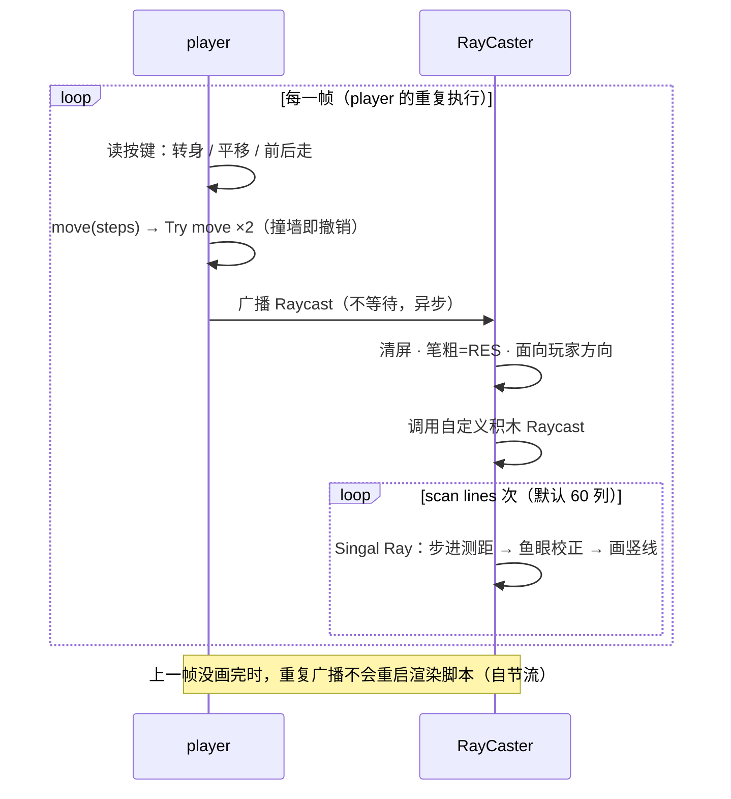

# Scratch 3D · 2D 伪 3D 光线投射（Raycasting）

纯 Scratch 画笔实现的伪 3D 第一人称渲染（Wolfenstein 3D 风格）：没有贴图、没有扩展，画面由 60 根射线逐列画出。

> **一句话原理**：你看到的"3D"其实是画出来的——
> **2D 地图 + 一排光线 + 近高远矮 = 眼睛看到的 3D。**
> 光线撞墙飞得越近，那一列墙就画得越高；飞得越远，画得越矮。

本文由两份材料合并而成：**手写笔记的教学讲解**（原理直觉）+ **工程实现剖析**（调用方式与数据流）。两大重点：

- **★ 调用方式** —— 谁调用谁、参数和数据怎么传递（§3）
- **★ 光线投射原理** —— 2D 地图如何一步步"拍"成 3D 画面（§4）

## 目录

1. [快速上手](#1-快速上手)
2. [项目组成一览](#2-项目组成一览)
3. [★ 调用方式](#3--调用方式)
4. [★ 光线投射原理](#4--光线投射原理)
5. [变量与数据流](#5-变量与数据流)
6. [地图](#6-地图)
7. [已知问题与调优](#7-已知问题与调优)
8. [附录：术语小词典 · 文档来源](#8-附录)

## 1. 快速上手

用 Scratch 3 编辑器打开 `Scratch 3D.sb3`，点击绿旗。

| 按键 | 动作 |
|:---:|:---|
| `W` / `↑` | 前进 2 步 |
| `S` / `↓` | 后退 2 步 |
| `A` / `D` | 左 / 右平移 |
| `←` / `→` | 平移 2 步 + 转身 15°（两件事同时发生） |

## 2. 项目组成一览

| 角色 | 造型 | 职责 |
|------|------|------|
| Stage | 渐变背景 | 存全局变量；背景即"天花板+地板"（地平线处黑） |
| `level` | 灰色墙体 SVG | 隐身（幽灵 100），只作为**碰撞体** |
| `level color` | 同图两份偏移副本 | 隐身，只用于**墙面颜色判定** |
| `player` | 箭头 + hitbox | 键盘输入、分轴碰撞、每帧广播触发渲染 |
| `RayCaster` | hitbox | **渲染核心**：发射射线、逐列画竖线 |

四个逻辑角色全程隐身——观众看到的一切都由画笔画出。`.sb3` 本质是 ZIP：`project.json` 装着全部脚本定义，其余为按 md5 命名的 SVG/PNG/WAV 素材。

## 3. ★ 调用方式

### 3.1 三种调用机制

本项目恰好用满了 Scratch 的三种"调用"手段，正好对应通用编程里的三种控制流：

| 机制 | 类比通用编程 | 本项目中的用法 | 关键特性 |
|------|-------------|---------------|---------|
| 🚩 绿旗启动 | `main()` | 4 条脚本并行启动、各自初始化 | 同时开始，之后各走各的 |
| 🧩 自定义积木 | 同步函数调用 `f(x, y)` | `move` / `Try move` / `Raycast` / `Singal Ray` | **带参数**，调用处暂停等它执行完才继续，无返回值 |
| 📡 广播 | 异步事件 / 消息 | `broadcast Raycast` 触发渲染 | **不带参数**，发送方不等待，且不打断已在运行的接收脚本 |

### 3.2 调用关系全图

```
🚩 绿旗被点击（4 条脚本并行）
 ├─ level        : 移到 (0,0) → 幽灵 100（只留碰撞体）
 ├─ level color  : 移到 (0,0) → 幽灵 100（只留判定体）
 ├─ player       : 移到 (0,10)、面向 45°、隐身 → 进入主循环 ↓
 └─ RayCaster    : FOV=60、RES=8、切 hitbox 造型、不旋转、隐身待命


player「重复执行」（每圈 ≈ 一帧）
 │
 ├─ 读按键（同帧可叠加）：
 │    W/↑ → move(2)      S/↓ → move(-2)
 │    A   → 左转90° → move(2) → 转回（左平移）
 │    D   → 右转90° → move(2) → 转回（右平移）
 │    ←/→ → 平移 + 转身 15°
 │
 │    move(steps)                          ← 自定义积木（同步）
 │     ├─ 切 hitbox 造型（4×4px 判定盒）、不旋转
 │     ├─ Try move(steps·sinθ, 0)          ← 自定义积木：先走 x 轴
 │     │    └─ 碰到 level ? x 反向撤销
 │     ├─ Try move(0, steps·cosθ)          ← 自定义积木：再走 y 轴
 │     │    └─ 碰到 level ? y 反向撤销
 │     └─ 切回 player 造型、恢复旋转
 │
 └─ 📡 广播 [Raycast] ─────────────────────┐（异步：不等画完）
                                           ▼
RayCaster「当接收到 Raycast」
 ├─ 清空画笔、笔粗 = RES、颜色参数 = 53
 ├─ 面向 (player 的方向)
 └─ Raycast()                              ← 自定义积木（同步）
     ├─ dir ← 当前方向（玩家朝向快照）
     ├─ X ← RES/2 − 240（首列坐标）
     ├─ 左转 FOV/2（对准视野左缘）
     └─ 重复 scan lines 次（= 480/RES = 60）
         ├─ Singal Ray()                   ← 自定义积木：一根射线 + 一列竖线
         ├─ 右转 FOV / scan lines 度（= 1°）
         └─ X 增加 RES
```

### 3.3 每帧时序



两个值得注意的行为，都来自广播的天然性质：

- **异步解耦**：player 广播后不等待，继续下一圈读按键；渲染在 RayCaster 里独立进行；
- **自节流**：Scratch 规定广播不打断正在运行的接收脚本——渲染慢时，主循环发来的多余广播被自动丢弃，活儿不会越积越多。

### 3.4 自定义积木一览（相当于函数）

| 自定义积木 | 定义于 | 参数 | 职责 | 调用者 | 每帧次数 |
|-----------|--------|------|------|--------|:-------:|
| `move (steps)` | player | 步数 | 切判定盒 → 分轴移动 → 切回 | player 主循环 | 1–2 |
| `Try move (dx)(dy)` | player | x / y 位移 | 单轴移动 + 碰墙撤销 | move | 2 |
| `Raycast` | RayCaster | — | 设扫描起点，循环 60 列 | 接收广播脚本 | 1 |
| `Singal Ray` | RayCaster | — | 单根射线：步进测距 + 画一列 | Raycast | 60 |

> 注：`Singal Ray` 为原项目笔误，应为 `Single Ray`（单根射线）。

### 3.5 参数与数据怎么传

- **自定义积木**：参数直达调用栈——`move(steps)` → `Try move(dx, dy)`，一层传一层；
- **广播**：不能带参数。渲染所需的"玩家朝向"由 RayCaster 收到广播后自己用 `面向 (player 的方向)` 现场获取；
- **没有返回值怎么办**：Scratch 自定义积木无法返回结果，本项目用变量当"管线寄存器"——`dir`、`X`、`distance`、`height` 在 `Raycast → Singal Ray` 两级之间逐级写入、就地读取（详见 §5）。这是 Scratch 渲染管线最典型的数据流模式。

## 4. ★ 光线投射原理

### 4.1 核心思想：2D 地图 + 扇形射线 = 3D 画面

Raycasting 的全部魔法只有一句话：**从玩家眼睛向视野扇形发出一排探针，每个探针撞墙的距离，决定屏幕上一列竖线的高度。** 距离近 → 线画得高；距离远 → 线画得矮。几十根竖线排在一起，人眼自动脑补出立体感。

```
（俯视：2D 地图平面）                      （第一人称：屏幕画面）

        E ← 玩家探针                        ┌────────────────────────┐
      ╱ │ ╲                                 │ ▓▓▓▓▓▓▓      ▒▒▒▒▒▒▒▒▒ │
    ╱   │   ╲    每根射线撞墙的距离           │ ▓▓▓▓▓▓▓▓▓    ▒▒▒▒▒▒▒▒▒ │
  ╱ d=12 │ d=30 ╲   决定一列墙的高矮          │ ▓▓▓▓▓▓▓▓▓▓▓  ▒▒▒▒▒▒▒▒▒ │
╱────────┼───────╲────── 墙               └────────────────────────┘
  近处的墙 → 列高          远处的墙 → 列矮    60 根射线 = 60 列，拼成一帧
```

`player` 和 `RayCaster` 其实都是"探针"：一个在地图里走（被你控制），一个替你眨眼（每帧扫一圈）。

> 🧱 **为什么"近高远矮"能骗过眼睛**：现实里同样一面墙，离你越近看起来越大。
> 把"距离 d"翻译成"列高 h"，大脑就自动把平面图脑补成了 3D——
> 这就是走廊尽头画得矮、两侧近墙画得高的原因。

### 4.2 第一步：扇形扫描

```
            E
         ╱  │  ╲       ① 先左转 FOV/2 = 30°，对准视野左缘
       ╱    │    ╲     ② 每画完一列右转 FOV/60 = 1°
     ╱      │      ╲   ③ 60 根后正好扫过 FOV = 60°
   ╱  视野60°│       ╲
```

| 参数 | 值 | 换算关系 |
|------|-----|---------|
| `FOV` | 60° | 每根射线间隔 = FOV ÷ 60 = **1°** |
| `RES` | 8px | 列数 = 480 ÷ RES = **60**，即画笔粗细 |
| 首列坐标 `X` | −236 | = RES/2 − 240；每列 +8，末列 +236 |

`RES/2 − 240` 这个起点是个小技巧：让 8px 宽的笔触正好**居中**落在每列上，60 列 × 8px = 480px 恰好铺满舞台。

> 📝 **从手写笔记到工程**：笔记的原始设想是"屏幕 480px 宽、每列一根 = **480 根光线**"，
> 画面最细腻，但每帧 480 次投射对 Scratch 太吃力。工程实际取 **RES=8**（每 8px 一根、60 根/帧），
> 速度快了 8 倍——**用分辨率换性能**的经典取舍。想调回来见 §7 调优速查。

### 4.3 第二步：射线步进测距（Ray Marching）

Scratch 不会"求射线与墙的交点"，就用最朴素的方法——让探针自己走过去：

```
移到 (player)                    ← 从玩家位置出发
重复直到 <碰到 level ?>           ← 大步冲：每次 2px
    移动 (2) 步
重复直到 <没有碰到 level ?>       ← 小步退：每次 0.5px
    移动 (-0.5) 步
```

大步保证速度（过冲 ≤2px），小步回退保证精度（误差 ≈0.5px + 4×4px 判定盒）。停稳后"到 player 的距离"就是这根射线的撞墙距离。RayCaster 恒为 hitbox 造型 + 不旋转——它本身就是那根在地图上移动的探针。

### 4.4 第三步：鱼眼校正（不修就会变成香蕉）

直接用步进量到的距离画墙，笔直的墙会**鼓成弧形**。原因看俯视图：

```
              E
        ╱     |     ╲
      ╱       |       ╲
    ╱ d≈11.5  | d=10   ╲ d≈11.5      垂直打墙的射线最短（10），
  ╱           |           ╲          斜 30° 的射线更长（11.5），
═══════════════════════════════ 墙   但它们打的是同一面平墙！
```

同一面平墙，斜看的射线径向距离更长（`射线长 = 垂直距离 ÷ cos(偏角)`）。若不修正，两边的墙会按 11.5 画矮——中间凸、两边凹，正是鱼眼畸变。**治法一行**：

```
距离 = 距离 × cos(射线方向 − 玩家方向)
```

11.5 × cos 30° ≈ 10——三根射线换算后距离一致，墙直了。这就是 §5 里 `dir`（玩家朝向快照）存在的意义：每根射线都要拿它来算偏角。

### 4.5 第四步：投影成墙（近大远小）

```
 高 ┌──┐
    │▓▓│ ← d=20 → h = 4000÷20 = 200，撑满屏幕
    │▓▓│
    └──┘┌─┐
        │▒│ ← d=80 → h = 4000÷80 = 50
        │▒│
────────┴─┴──────────  底
```

```
height = 4000 / distance
移到 x:(X) y:(+height) → 落笔 → y 设为 (-height) → 抬笔
```

墙高与距离成**反比**，画笔从 `(X, +h)` 竖直画到 `(X, −h)`。常数 4000 就是投影焦距：调大整体拉近，调小整体拉远。舞台高 360px，所以 `d ≤ 22` 时这面墙撑满全屏。

### 4.6 第五步：明暗与颜色

**距离雾化**——像手电筒没电：

```
笔的亮度 = 120 − distance        ← d≤20 全亮；d≥120 沉入全黑
```

背景渐变（地平线黑、上下边缘白）用的同一套逻辑，天花板、地板与墙无缝衔接。

**墙面双色**——`level color` 的妙用：它把同一张地图画了两遍（偏移 `(1,0)` 和 `(5,1)`），效果是每面墙在 +x/+y 一侧多出约 4px 的"边缘"、另一侧内缩 1px。射线停稳后摸一摸：

- 碰得到边缘 → 色号 58（偏蓝）
- 碰不到 → 色号 53（偏青）

朝向不同方向的墙因此颜色不同——零成本的**朝向着色**，再叠加距离雾化，画面立刻有了层次。

### 4.7 五步串起来

```
① 扇形扫描（60 根、1° 间隔） → ② 步进测距（2px 冲 / 0.5px 退）
→ ③ 鱼眼校正（×cos 偏角） → ④ 投影（h = 4000/d，画竖线）
→ ⑤ 上色（亮度 120−d，色号 58/53）
每根射线跑一遍 ②③④⑤，60 根 = 一帧
```

## 5. 变量与数据流

| 变量 | 归属 | 写入者 | 读取者 | 含义 |
|------|------|--------|--------|------|
| `FOV` | 全局 | RayCaster 初始化 | Raycast | 视场角（60°） |
| `RES` | 全局 | RayCaster 初始化 | 广播接收 / Raycast / Singal Ray | 列宽 = 画笔粗细 |
| `scan lines` | 全局 | Raycast | Raycast | 每帧射线数 = 480 ÷ RES |
| `X` | 全局 | Raycast | Singal Ray | 当前列的屏幕 x 坐标 |
| `distance` | 全局 | Singal Ray | Singal Ray | 射线距离（先径向，后原地乘 cos 校正） |
| `dir` | RayCaster 局部 | Raycast | Singal Ray | 扫描开始时的玩家朝向快照（鱼眼校正用） |
| `height` | RayCaster 局部 | Singal Ray | Singal Ray | 当前列的墙高（px） |
| `我的变量`、player 的 `height` | — | — | — | 未使用的残留变量 |

按"谁检测谁"看，三个隐身角色就是三个对象：

| 被检测对象 | 谁检测它 | 用途 |
|-----------|---------|------|
| `level` | player 的 Try move | 碰撞回退 |
| `level` | RayCaster 的 Singal Ray | 射线命中（步进终止条件） |
| `level color` | RayCaster 的 Singal Ray | 墙面朝向 → 颜色判定 |
| `player` | RayCaster 的 Singal Ray | 射线起点 + 测距锚点 |

## 6. 地图

`level` 的 SVG（灰色 #808080）以角色中心放在 (0,0)。示意图（横向 1 字符 ≈ 10px，纵向 1 行 ≈ 20px）：

```
################################################
###                   ####           ###     ###
###                   ####           ###     ###
###                   ####           ###     ###
###                   ####           ###     ###
###   ######          ####           ###     ###
###   ######          ####           ###     ###
###   ######                         ###     ###
###   ######            P                    ###
###           #####################          ###
###           #####################          ###
###           ####                           ###
###           ####             ####  #####   ###
###           ####             ####  #####   ###
###           ####             ####  #####   ###
###           ####             ####          ###
###           ####             ####          ###
################################################
```

`#` = 墙体，`P` = 出生点（舞台坐标 (0,10)，朝向 45°）。构成：厚 25–34px 的外墙、中部竖柱、左中方块、两段 L 形内墙、一根半径约 20px 的圆柱，以及 4 个小圆点（它们同样会被射线命中，画成细柱）。

## 7. 已知问题与调优

**代码卫生**

- `Singal Ray` 应为 `Single Ray`；
- `(120 − (distance / 1))` 中的 `/1` 无作用；
- `我的变量` 与 player 局部 `height` 是残留变量；
- 广播接收脚本里"颜色参数设为 53"会被每根射线覆盖，属冗余初始化。

**精度**：射线定位受判定盒（4×4px）与回退步长（0.5px）限制，紧贴墙面时边缘略有抖动。

**调优速查**

| 想要 | 改什么 | 代价 |
|------|--------|------|
| 画面更细 | `RES` 8 → 4（120 根射线） | 帧率下降 |
| 跑得更顺 | `RES` 8 → 16（30 根射线） | 马赛克 |
| 视野更宽 | `FOV` 60 → 90 | 边缘拉伸 |
| 看得更远 | 步长 2 → 5 | 近处误差变大 |
| 场景拉近/拉远 | 投影常数 4000 | — |

**扩展方向**：墙面贴图、地板/天花板纹理、精灵投影（对每个物件发一根射线，用同样的投影公式算高度后切换造型）。

## 8. 附录

### 8.1 术语小词典

| 术语 | 是什么 |
|---|---|
| **Raycasting 光线投射** | 从观察者发出一排光线探测场景，按命中结果逐列画图的技术 |
| **Ray Marching 步进测距** | 不会求射线与墙的交点，就让探针一小步一小步走过去撞（§4.3） |
| **FOV 视场角** | 玩家视角扇形的张角，决定一帧画面扫多宽 |
| **鱼眼畸变** | 不做 cos 校正时，笔直的墙在屏幕上鼓成弧形（§4.4） |
| **碰撞箱 / hitbox** | 看不见、但能让光线和玩家"撞上"的隐形边界，本工程里是 `level` |
| **广播** | Scratch 的消息机制：一个角色喊话，听到广播的角色执行自己的脚本 |

### 8.2 文档来源

- **手写笔记**（2026-10-01 整理入库）：光线投射的基本设想——player 视线与距离 d、
  近高远矮、"player 运动 → 广播 Raycast → 碰撞箱接收"事件流、FOV 设定与逐角投射；
- **`Scratch 3D.sb3` 工程解剖**（project.json 与积木统计实测核对）：角色分工、
  调用关系、变量数据流、调优参数均以现行工程为准。

---

<div align="center">

**2D 地图 + 一排光线 + 近高远矮 = 眼睛看到的 3D** 🧱

</div>
